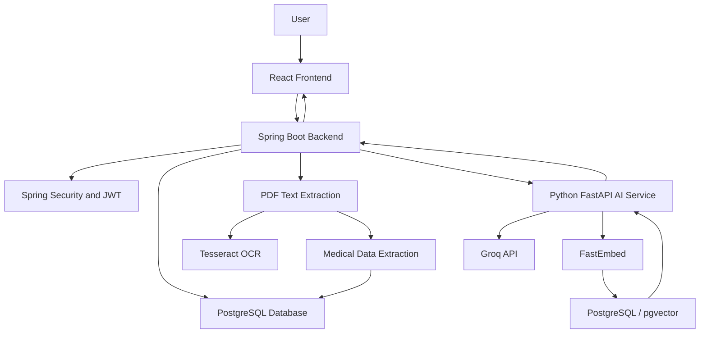

# MediLens AI -- AI-Powered Medical Report Analyzer

MediLens AI is a full-stack medical report analysis platform that helps
users upload, understand, review, and manage their medical reports using
AI-assisted explanations and intelligent document processing.

The platform combines document extraction, OCR, deterministic medical
range classification, AI-powered explanations, and Retrieval-Augmented
Generation (RAG) to make medical reports easier to understand.

> **Disclaimer:** MediLens AI is an informational tool, not a substitute
> for professional medical advice, diagnosis, or treatment.

## Project Overview

MediLens AI provides an integrated platform for processing medical
reports and presenting extracted health information through an
interactive dashboard.

### Key Features

-   **User Authentication:** Secure registration and login with
    JWT-based authentication.
-   **Medical Report Upload:** Upload PDF medical reports for
    processing.
-   **PDF Text Extraction:** Extract text from digital PDF documents
    using Apache PDFBox.
-   **OCR Processing:** Use Tesseract OCR for scanned medical documents.
-   **Medical Data Extraction:** Identify and structure medical test
    names, values, units, and reference ranges.
-   **Extraction Review:** Review and manually correct extracted medical
    test results.
-   **Medical Range Classification:** Classify test results using
    deterministic reference-range logic.
-   **AI-Powered Explanations:** Generate understandable explanations of
    medical test results.
-   **Report Summaries:** Generate AI-assisted summaries of uploaded
    reports.
-   **RAG-Based Report Chat:** Ask questions about individual reports
    using retrieved report context.
-   **Dashboard Analytics:** View key statistics, charts, and report
    information.
-   **Report History:** Access and manage previously uploaded reports.
-   **Health Trends:** Visualize changes in test results over time.
-   **Export and Print:** Export and print report information.

## Technology Stack

  Component            Technologies
  -------------------- -----------------------------
  Frontend             React.js, Vite, Material UI
  Backend              Java 17, Spring Boot
  Security             Spring Security, JWT
  ORM                  Hibernate / Spring Data JPA
  Database             PostgreSQL
  Database Migration   Flyway
  PDF Processing       Apache PDFBox
  OCR                  Tesseract OCR
  AI Service           Python, FastAPI
  AI Integration       Groq API
  Embeddings           FastEmbed
  Vector Search        PostgreSQL with pgvector
  API Communication    REST APIs
  Version Control      Git and GitHub

## System Architecture



### Report Processing Workflow

1.  The user uploads a medical report through the React frontend.
2.  The Spring Boot backend receives and validates the uploaded
    document.
3.  PDFBox extracts text from digital PDFs.
4.  Tesseract OCR processes scanned documents when required.
5.  The backend extracts structured medical test information.
6.  Extracted results are reviewed and classified using reference
    ranges.
7.  The Python AI service generates explanations and report summaries.
8.  Report content is embedded and indexed for report-specific RAG
    conversations.
9.  Results are stored in PostgreSQL and displayed on the dashboard.

## Project Structure

``` text
MediLens-AI/
├── frontend/
│   ├── public/
│   ├── src/
│   │   ├── assets/
│   │   ├── components/
│   │   ├── context/
│   │   ├── hooks/
│   │   ├── pages/
│   │   ├── routes/
│   │   ├── services/
│   │   ├── App.jsx
│   │   └── main.jsx
│   ├── package.json
│   └── vite.config.js
│
├── backend/
│   ├── medilens-ai-service/
│   │   ├── app/
│   │   │   ├── schemas/
│   │   │   └── services/
│   │   ├── main.py
│   │   └── requirements.txt
│   │
│   ├── src/
│   │   ├── main/
│   │   │   ├── java/
│   │   │   └── resources/
│   │   └── test/
│   ├── pom.xml
│   └── mvnw.cmd
│
├── docs/
│   └── screenshots/
│       ├── landing-page.png
│       ├── dashboard.png
│       ├── dashboard-analytics.png
│       ├── recent-activity.png
│       ├── report-history.png
│       ├── upload-report.png
│       ├── report-analysis.png
│       └── ai-report-chat.png
│
├── .gitignore
└── README.md
```

## Getting Started

### Prerequisites

Install the following software before running the application:

-   Java Development Kit 17
-   Node.js and npm
-   Python 3.10 or a compatible version supported by the AI service
    dependencies
-   PostgreSQL
-   Tesseract OCR
-   Git

### 1. Clone the Repository

``` bash
git clone https://github.com/Prashanthbkm/MediLens-AI.git
cd MediLens-AI
```

### 2. Database Setup

Create a PostgreSQL database:

``` sql
CREATE DATABASE medilens_db;
```

Configure your database credentials using environment variables.

The backend uses Flyway for database migrations.

### 3. Backend Setup -- Spring Boot

Navigate to the backend directory:

``` bash
cd backend
```

Configure the required environment variables in your local environment:

``` env
DB_PASSWORD=your_database_password
JWT_SECRET=your_secure_jwt_secret
```

Run the Spring Boot application from the backend directory on Windows:

``` cmd
mvnw.cmd spring-boot:run
```

The backend is configured to run on:

``` text
http://localhost:8080
```

### 4. AI Service Setup -- Python FastAPI

Navigate to the AI service directory from the repository root:

``` bash
cd backend/medilens-ai-service
```

Create and activate a virtual environment:

``` bash
python -m venv venv
```

Windows:

``` cmd
venv\Scripts\activate
```

Install dependencies:

``` bash
pip install -r requirements.txt
```

Create a local `.env` file with your AI and database configuration:

``` env
GROQ_API_KEY=your_groq_api_key
GROQ_MODEL=openai/gpt-oss-20b

DATABASE_HOST=localhost
DATABASE_PORT=5432
DATABASE_NAME=medilens_db
DATABASE_USER=postgres
DATABASE_PASSWORD=your_database_password
```

Use the exact environment variable names expected by your AI service
configuration.

Start the FastAPI service:

``` bash
uvicorn main:app --reload --port 8000
```

AI service URL:

``` text
http://localhost:8000
```

### 5. Frontend Setup -- React

Open a new terminal from the repository root and navigate to the
frontend:

``` bash
cd frontend
```

Install dependencies:

``` bash
npm install
```

Start the development server:

``` bash
npm run dev
```

The frontend will be available at:

``` text
http://localhost:5173
```

Ensure that the frontend API configuration points to your running
backend.

## Environment Variables and Security

Sensitive configuration must never be committed to GitHub.

Keep the following information private:

-   Groq API keys
-   Database passwords
-   JWT signing secrets
-   Production credentials
-   User-uploaded medical reports

The repository uses `.gitignore` to exclude environment files, build
folders, virtual environments, logs, and uploaded reports.

Create your own local `.env` files when setting up the project. Never
commit real `.env` files or API keys.

## Screenshots

### 1. Landing Page


### 2. Dashboard


### 3. Dashboard Analytics


### 4. Recent Activity


### 5. Report History


### 6. Upload Medical Report


### 7. Medical Report Analysis


### 8. AI Report Chat


## Future Enhancements

-   Production deployment with cloud infrastructure.
-   Improved multilingual medical report support.
-   Enhanced document extraction accuracy.
-   More advanced report comparison and trend analysis.
-   Improved report citations and source references.
-   Expanded automated testing and monitoring.

## Learning Outcomes

This project demonstrates practical experience with:

-   Full-stack application development.
-   REST API design and integration.
-   JWT authentication and authorization.
-   Relational database design and migrations.
-   PDF processing and OCR.
-   AI API integration.
-   Embeddings and vector search.
-   Retrieval-Augmented Generation (RAG).
-   Data visualization and dashboard development.
-   Git-based version control.

## Author

**Prashanth B.K.M.**

Full-Stack Developer \| Java \| Spring Boot \| React.js \| Python \| SQL

GitHub: [@Prashanthbkm](https://github.com/Prashanthbkm)

Project Repository: [MediLens
AI](https://github.com/Prashanthbkm/MediLens-AI)

------------------------------------------------------------------------

**Built with a vision to make medical reports easier to understand
through technology.**
